# MinUI+

**MinUI+ is a fork of [MinUI](https://github.com/shauninman/MinUI) for the Miyoo A30 that brings together the best
of MinUI, [Onion](https://github.com/OnionUI/Onion) and [spruce](https://github.com/spruceUI/spruceOS).** It keeps
what makes MinUI great: one simple launcher, the same quick in-game menu everywhere, instant sleep and resume. Then it
adds what people love about Onion and spruce: a box art carousel, RetroAchievements, play time tracking, a game
switcher, menu music, borders and screen effects, Wi-Fi, per-game emulator cores, themes, and a lot of work on speed
and battery life. All of it rebuilt to feel like MinUI: fast, quiet and out of the way.

It's preconfigured to look its best from the first boot: every system has its border, LCD grid or scanlines,
LCD ghosting and color correction already set up, and the CPU speed adjusts itself to each game.

**Why:** the A30 is an underrated little handheld and a perfect everyday carry. It deserves an OS as polished and
optimized as Onion, without the clunkiness that comes with running everything through RetroArch.

<p align="center">
  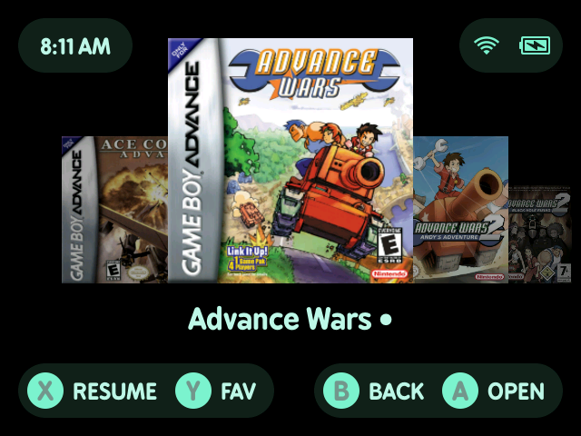
  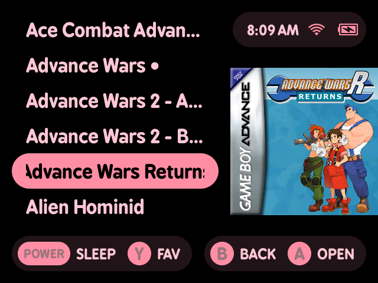
</p>

> MinUI+ is made for and tested on the **Miyoo A30** only.

- [Screenshots](#screenshots)
- [What's new in v1.1](#whats-new-in-v11)
- [Highlights](#highlights)
- [Installing](#installing)
- [The launcher](#the-launcher)
- [In game](#in-game)
- [Systems and cores](#systems-and-cores)
- [BIOS files](#bios-files)
- [Nintendo DS](#nintendo-ds)
- [Nintendo 64](#nintendo-64)
- [Tools](#tools)
- [Speed and battery](#speed-and-battery)
- [Controls](#controls)
- [Folders on the card](#folders-on-the-card)
- [Building](#building)
- [Feedback and bugs](#feedback-and-bugs)
- [Credits](#credits)

## Screenshots

The launcher screens are MinUI+'s own code drawing at the A30's 640x480, captured on a computer. The in-game ones
were taken by the A30 itself, border and LCD grid included.

| | |
| :---: | :---: |
| 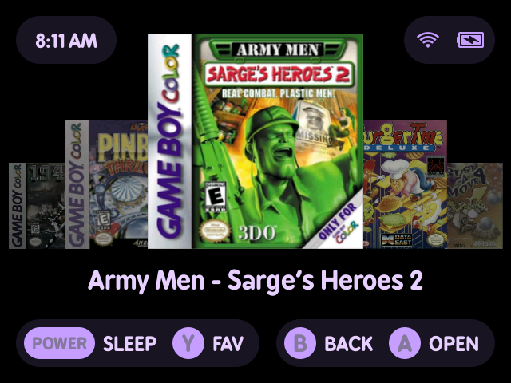 | 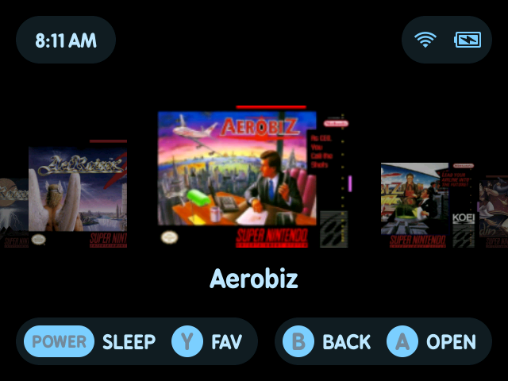 |
| **Box art carousel**, sliding as you scroll | One look for every system, in any theme |
| 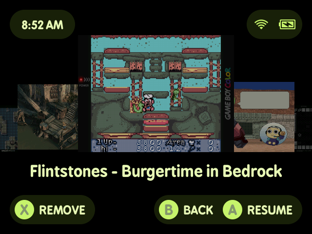 | 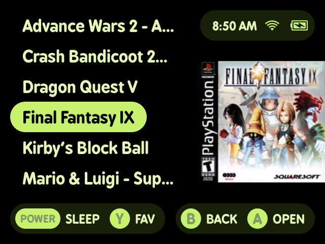 |
| **Game switcher**: hold MENU, pick up any game where you left it | **Favorites** from every system in one list |
| 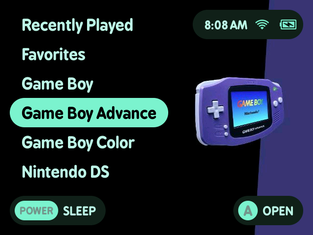 | 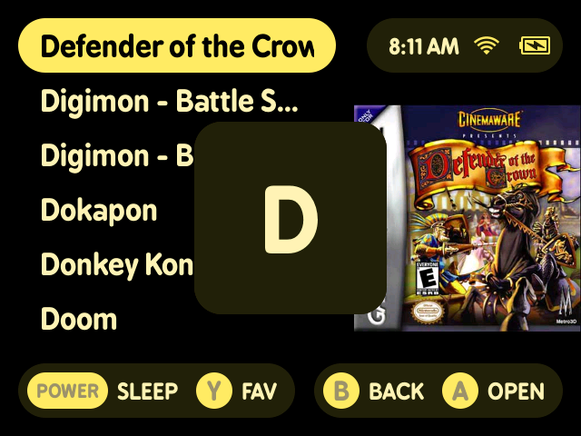 |
| **Systems** with their own art | **L1 / R1** jump by letter |
| 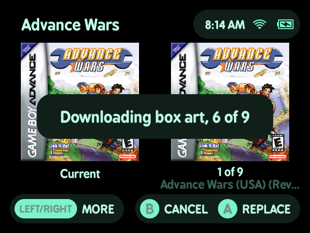 | 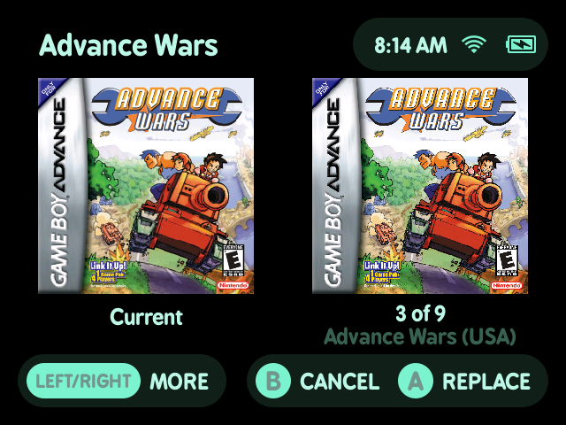 |
| **Box art** downloaded on the device | Every match side by side with yours, to pick from |
| 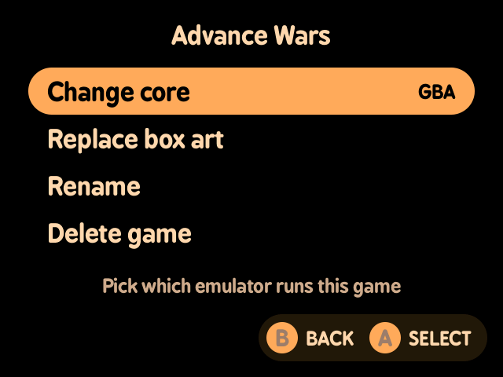 | 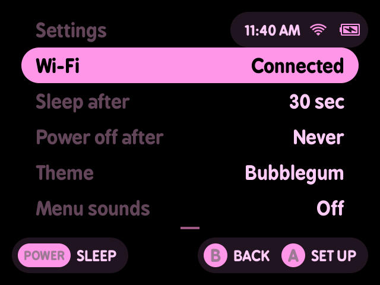 |
| **Game menu**: core, box art, rename, delete | **Settings**: Wi-Fi, timers, themes, sounds, music, clock |
| 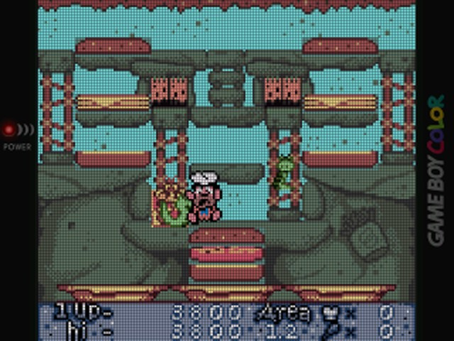 | 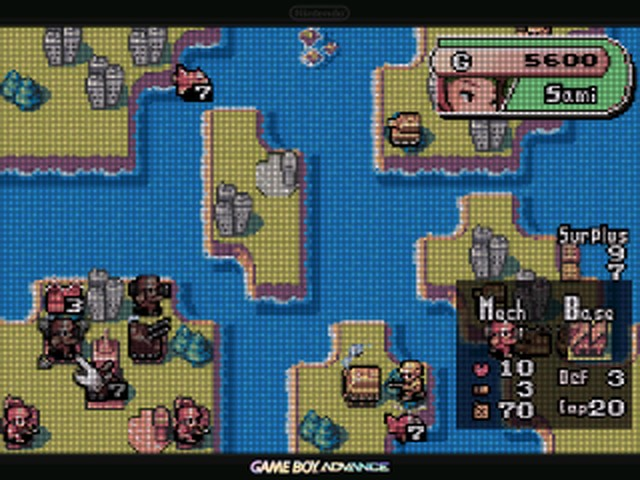 |
| **Native borders**: the Kiwi lime Game Boy Color | **LCD grid** and border on the GBA |
| 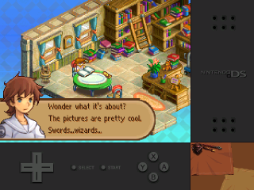 | 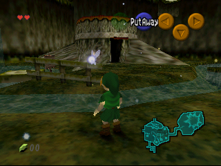 |
| **[Nintendo DS](#nintendo-ds)** with a border and both screens | **[Nintendo 64](#nintendo-64)**, experimental |
| 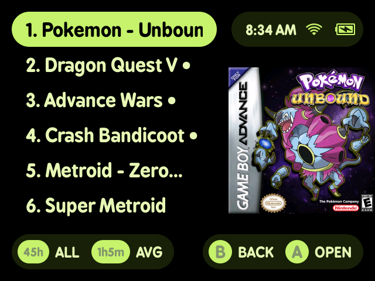 | 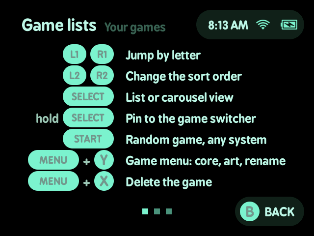 |
| **Play Time**: your games ranked by hours played | **Controls**: the shortcuts you can't see |

<p align="center">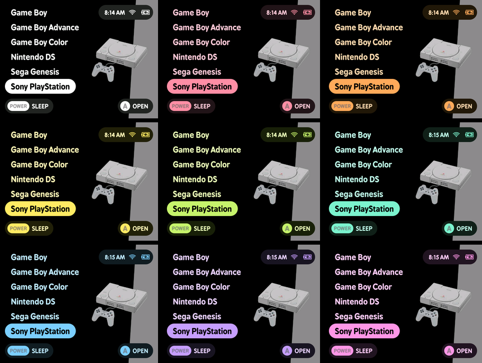<br><b>Color themes</b> for the whole interface (eleven in all)</p>

## What's new in v1.1

Everything that changed from v1.07. On v1.07 or older? [Install this one by hand](#updating), once.

**Nintendo DS**

- New system, through DraStic, which [you download yourself](#nintendo-ds)
- The same pause menu as every other system, with save states and their pictures, play time, the game switcher and
  resume
- Screen layouts, borders, Main Screen, Screen Effect, Prevent Tearing, and rebindable controls and shortcuts
- RetroAchievements (softcore)
- CPU Speed and Thumbstick rows in the game menu (MENU + Y)
- Renaming or deleting a DS game takes its saves, save states and settings along

**Nintendo 64** (still experimental, [your mileage may vary](#nintendo-64))

- Better speed and graphics overall, including lighting and off-screen effects
- Mario Tennis: improved effects around the ball and the screen after a replay. Some shimmering and odd textures
  remain in replays
- Banjo-Kazooie: improved the black pieces in its transitions, though it can still show visual problems
- Fixed a graphics memory leak

**Clock**

- New **Set time** in Settings sets the clock without Wi-Fi
- The clock now stays right while the A30 is off, and shows only once it's been synced over Wi-Fi or set by hand. It
  may stay hidden after this update until you do one of those

**Menus and saves**

- A game name too long for the pause menu now scrolls instead of being cut off
- A save state is written beside the old one first, so losing power mid-save no longer destroys the previous state
- The charging bolt now also shows on a wall charger

**RetroAchievements**

- It now logs why it couldn't connect, and no longer lists the server's notice about unrecognized emulators

**Updates**

- The built-in updater now checks [GitLab](https://gitlab.com/zavorin89-group/MinUI-Plus/-/releases)

## Highlights

- **Box art carousel**, plus box art beside the list, with art downloaded right on the device
- **Play time tracking** for every game: total hours, sessions, average session and this session, a **Most Played**
  ranking, and your all-time total
- **RetroAchievements**: unlock popups, an achievements list in the pause menu, and playing offline
  (unlocks are sent later), PlayStation `.chd` discs included
- **Game menu** (MENU + Y on a game): pick its emulator core, download its box art, rename it, delete it
- **Multi-disc games merge themselves**: drop in "(Disc 1)", "(Disc 2)"... files and MinUI+ turns them into one
  game, with a playlist and your saves carried over
- **Rename any game** right on the device (MENU + Y, Rename) without breaking anything: its saves, save states,
  box art, play time and favorite all follow the new name
- **Game switcher**: hold MENU anywhere, even mid-game, to jump between your pinned games, each shown as a picture of
  exactly where you left it and picking up from that moment
- **Favorites**: mark any game with Y and it joins one list with every system's favorites, with box art, in the
  list or the carousel, sorted A to Z, by system, or newest first
- **Background music** in the menus and the pause menu, from your own mp3, ogg, flac or wav files
- **Borders** for every handheld system, at aspect and at native scaling, in each console's own colors
- **Preconfigured looks**: LCD grid and ghosting on handhelds, scanlines on TV consoles, Game Boy Pocket greys,
  color correction for GBC and GBA
- **Nintendo DS** through DraStic, with the same in-game menu as every other system: save states, screen layouts,
  borders, CPU speed and RetroAchievements. [DraStic is a separate download](#nintendo-ds)
- **Nintendo 64**, experimental: [your mileage may vary](#nintendo-64)
- **Arcade and more**: Capcom Play System 1, 2 and 3, Final Burn Neo, MAME 2003+, Neo Geo, Sega CD and Sega 32X
- **Auto CPU speed**: each game runs at the lowest speed that keeps it smooth, and remembers what it needed.
  [Auto, Normal, Performance or Powersave](#cpu-speed), per system or per game
- **Rumble Strength**: one Off to 10 setting for every system with rumble, per system or per game, gentler than the
  stock full-power buzz
- **Updates on the device**: read the patch notes and install new versions over Wi-Fi
- **Wi-Fi** in the settings: scan, pick a network and type its password on the on-screen keyboard. Several networks
  can be saved, and it joins whichever is in range. Choose whether it connects at startup, and tools that need the
  internet offer to turn it on
- **Built for speed**: tuned until the A30's menus feel instant. They're GPU drawn, art decodes ahead of you on
  its own thread, the CPU boosts the instant you touch a button, and saving and the game switcher are quick
- **Efficient sleep**: the CPU drops to a crawl, audio and Wi-Fi switch off, the device lasts far longer asleep

## Installing

MinUI+ is one download with everything in it: every system, the borders and the tools.

1. Format a microSD card as **FAT32**.
2. Unzip `MinUIPlus-<date>.zip` and copy everything in it to the root of the card: the `miyoo` folder,
   `MinUI.zip` (leave it zipped), and the `Bios`, `Roms`, `Saves`, `BGM`, `Emus`, `Tools` and `Borders` folders.
3. Put your games in the fully named system folders in `Roms` (for example, `Game Boy Advance (GBA)`). Do not
   create shorter duplicate folders such as `GBA`. Put any BIOS files your systems need in `Bios`, insert the card
   and turn the A30 on. The first start installs MinUI+.

Some systems need more from you: [BIOS files](#bios-files) for Neo Geo and Sega CD among others, and DraStic for the
[Nintendo DS](#nintendo-ds). None of these, and no games, come with MinUI+.

### Updating

From v1.1 on, MinUI+ updates itself over Wi-Fi, from the
[latest GitLab release](https://gitlab.com/zavorin89-group/MinUI-Plus/-/releases/permalink/latest): see
[Updates](#settings-tap-menu).

**On v1.07 or older, install v1.1 by hand once**, since those versions only know the old address. Copy `MinUI.zip`
from the release to the root of the card (leave it zipped). To get the new systems too, also copy the zip's `Emus`
folder, `Tools`, `Roms`, `Bios` and `Borders`, leaving out anything you've changed. Your games, saves and settings are
kept.

## The launcher

### Views

- **Carousel**: the selected game's box art big in the middle, its neighbors either side, sliding as you scroll.
  SELECT switches between the carousel and the list.
- **List with art**: the classic MinUI list, with the selected game's box art beside it. The art stays up while you
  scroll, so the list doesn't jump.
- **Systems**: the system list, with system art.

### Finding games

- **L1 / R1** jump to the previous or next letter, with a big letter popup showing where you are.
- **L2 / R2** change the sort order: A to Z, Z to A, recently played, or favorites first.
- **START** picks a random game. In the system list it picks a random system too, and keeps picking from every
  system each time you press it, until you open a system yourself.
- **Favorites**, **Recently Played**, and **Most Played** (see [Favorites](#favorites) and [Play time](#play-time)).

### Favorites

- **Y** on any game, in any list, adds it to Favorites (or takes it off). Favorites show a dot beside their name.
- **Favorites** is right below Recently Played in the system list: every favorite from every system in one place,
  with its box art, as a list or a carousel.
- **L2 / R2** in Favorites sort it A to Z, by system, or the ones you added most recently first.
- In any system, **L2 / R2** can also sort **favorites first**, so your picks are always at the top.
- Favorites follow a game through a rename.

<p align="center">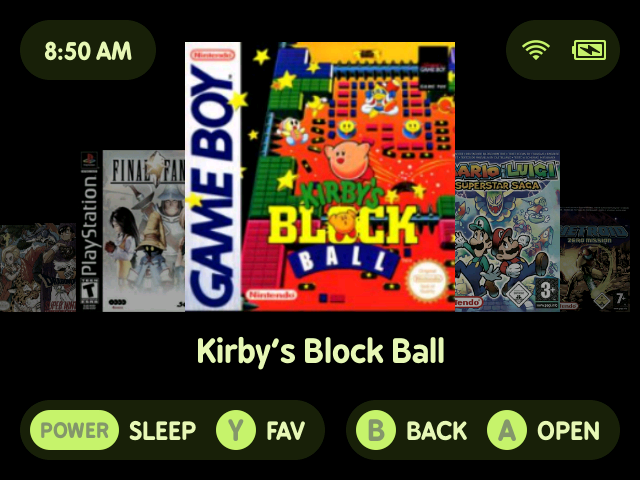</p>

### Play time

MinUI+ keeps track of how long you play every game, automatically, from the moment it starts:

- **In the pause menu**: the game's total play time, this session, how many sessions, and your average session.
- **Play Time** (in Tools): every game you've played, ranked by hours, with its box art, its total and its average
  session, and your total across everything as it opens. **MENU + X** there clears it all (it asks first).
- **Recently Played** is sorted by when you actually last played, and the time follows a game through a rename.


### The game menu (MENU + Y)

- **Change core**: some systems have more than one emulator. Pick one per game, with a line about what each is good
  at; the system's default stays on top. Saves and states are kept per core, so switching never loses progress.
- **CPU speed**: this game's [CPU speed](#cpu-speed), without starting it.
- **Rumble Strength**: Off or 1 to 10 for this game, on the systems with rumble.
- **Thumbstick** (Nintendo DS): whether the stick moves the stylus or acts as a second d-pad.
- **Get box art** / **Replace box art**: downloads this game's cover from the libretro thumbnail library (turns
  Wi-Fi on if you'd like). When there's more than one match (regions, revisions), every one is downloaded and shown
  beside the art you have, to flip through and pick from. Covers are resized to 250 pixels wide so they load fast.
- **Rename**: edit the game's name on the on-screen keyboard. Its box art, saves, save states, settings, border,
  play time, favorite, recents and collections all follow the new name. Multi-disc games too.
- **Delete game**: asks first, then whether to also delete its saves, and its box art.

### Multi-disc games

Just copy every disc into the system's folder, named the usual way, and MinUI+ does the rest the next time the menu
opens:

```
Roms/Sony PlayStation (PS)/Final Fantasy IX (Disc 1).chd
Roms/Sony PlayStation (PS)/Final Fantasy IX (Disc 2).chd
Roms/Sony PlayStation (PS)/Final Fantasy IX (Disc 3).chd
Roms/Sony PlayStation (PS)/Final Fantasy IX (Disc 4).chd
```

becomes one game, **Final Fantasy IX**, in its own folder with a playlist (`Final Fantasy IX.m3u`):

- It recognizes `(Disc 1)`, `(Disk 1)` and `(CD 1)`, in any case and with "of 4" or not, for `.chd`, `.cue`
  (with its `.bin` tracks), `.ccd`, `.pbp`, `.iso` and `.img`, up to 9 discs.
- **Your progress comes along**: the newest memory card and save states from any disc become the game's, and loading
  a state starts the disc it was made on.
- Recently Played, Favorites and the game switcher follow the game to its new place.
- A folder that already has its discs but no playlist gets one too. One that has a playlist is left alone.
- **Switching discs** in a game: in the pause menu, Continue shows the current disc. Press Left or Right to change it.

You can still set a game up by hand: put its discs in a folder, and an `.m3u` with the folder's name listing each
disc's file on its own line.

### Your own box art

Box art lives in a hidden `.res` folder inside each system's folder, as a PNG named after the game's file, extension
and all:

```
Roms/Game Boy Advance (GBA)/Mario.gba
Roms/Game Boy Advance (GBA)/.res/Mario.gba.png
```

The Box Art tool downloads covers for every game missing one (or replaces the ones you have, if you'd like) and
resizes them to 250 pixels wide so they load fast. It can also shrink the art you already have to the same size.

MENU + X deletes a game directly (still asking first).

### Game switcher (hold MENU)

Hold MENU anywhere, in the menus or in a game, to open the game switcher: your pinned games, each with a picture
of where you left it. A picks a game up from that exact moment. In a game, holding MENU quicksaves first, with a
"Saving" spinner if it takes a moment. Pin games with a long press of SELECT in a list, or X in the pause menu.

### Settings (tap MENU)

- **Wi-Fi**: the network you're on (or Off); A opens the Wi-Fi setup to scan, connect, or switch it off
- **Updates**: after Wi-Fi connects, MinUI+ quietly checks its latest GitLab release. When a newer one exists,
  **Update Available!** appears above the systems. Open it to read the patch notes and confirm the update; the
  progress bar follows the verified download and installation. When it is ready, choose **Shut Down**, then turn
  the A30 back on to finish, or choose **Later** to return to MinUI+ and shut down when convenient
- **Sleep after** and **Power off after** timers
- **Theme**: several color themes for the whole interface
- **Menu sounds**: subtle clicks for moving, opening and going back
- **Clock**: shows beside Wi-Fi and the battery, or at the top left in the carousel, once it's been set. It syncs
  every time Wi-Fi connects, and keeps its time while the A30 is off. 12-hour, 24-hour or off
- **Set time**: sets the clock by hand, no Wi-Fi needed
- **Time zone**: Automatic (looked up from your connection the first time it syncs) or pick yours, daylight saving
  included
- **Sleep light**: whether the power light stays on while asleep
- **Swap A and X**: A resumes and X opens in game lists, if you'd rather
- **Music**: background music on or off, and its volume (Left/Right). Put songs in the `BGM` folder
- **MinUI+ version**: shown subtly in the final row at the bottom

### Music

Background music plays in the launcher and in a game's pause menu, never while you play. Put **mp3, ogg, flac or
wav** files in `BGM` at the top of the card and turn on Music in the settings. Songs play shuffled, each once
before any repeats, fading in and out. In the pause menu the song picks up where it left off between visits. It's
decoded a little ahead on a lowest-priority thread, so it never slows the menus: about 2% of the CPU.

### Look and feel

- Volume, brightness and every popup fade out smoothly
- Long game names scroll across instead of running under the box art
- Menu sounds: soft clicks for moving, opening and going back, switched on or off in the settings
- MinUI keeps its place in the menus, even when you quit a game from its pause menu
- MENU dismisses an achievement popup instead of opening the pause menu

## In game

### Pause menu

The MinUI pause menu, quicker to open, with:

- **Save / Load** with a picture of each save state slot as the game looked, border and grid included
- **Achievements** (with RetroAchievements set up): every achievement with its badge, locked or unlocked, sortable
- **Options**: emulator options, controls and shortcuts, now with clicks for moving and changing values
- **A long game name** scrolls instead of being cut off
- **Music** from the `BGM` folder, if it's on
- **X** pins the game to the game switcher

Save states are written beside the old one first, so losing power mid-save doesn't destroy the previous state.

### Screen

- **Borders**: each handheld has a border at aspect scaling, and at native scaling a full console face in its shell
  color (silver Game Boy Pocket, Kiwi lime Game Boy Color, indigo Game Boy Advance, black Game Gear, Neo Geo Pocket
  and Color) with a dark screen lens, a glowing power light and the console's logo. Turn them on or off per system
  in Options > Frontend > Screen Border. Add your own as `Borders/<SYSTEM>.png` (or `<SYSTEM>-native.png`), or for one
  game as `Borders/<SYSTEM>/<game file>.png`.
- **Effects**: an LCD grid, or scanlines, at every scaling.
- **LCD ghosting**: handhelds blend frames like their slow original screens did.
- **Color correction**: GBC and GBA colors as their dim original screens showed them, instead of oversaturated.
- **Game Boy Pocket look**: original Game Boy games in the Pocket's near black-and-white greys.

### RetroAchievements

Sign in with the RetroAchievements tool (on the on-screen keyboard), then just play:

- Unlock popups with the achievement's badge and a chime, and a summary when a game starts
- Games with no achievements, or that RetroAchievements doesn't know, show nothing at all
- **No hardcore mode**: RetroAchievements only counts hardcore unlocks from emulators it has approved, and
  MinUI+ isn't one, so unlocks are softcore.
- **Nintendo DS** games work the same way, softcore too
- **Offline**: unlocks earned without Wi-Fi are kept and sent the next time you're online. The tool syncs your games
  ahead of time so their achievements and badges work offline, and a rescan only looks at games that are new or changed
- PlayStation `.chd` games are identified too

## Systems and cores

| System | Folder tag | Default core | Other cores (pick per game) |
| --- | --- | --- | --- |
| Game Boy | GB | gambatte | |
| Game Boy Color | GBC | gambatte | |
| Game Boy Advance | GBA | gpSP | mGBA |
| NES | FC | FCEUmm | |
| Super Nintendo | SFC | snes9x 2005 | snes9x 2010, snes9x (current), Supafaust (the newer snes9x cores run ROM hacks the 2005 one can't) |
| Genesis | MD | PicoDrive | |
| PlayStation | PS | PCSX ReARMed | |
| Game Gear, Master System | GG, SMS | PicoDrive | |
| Neo Geo Pocket / Color | NGP, NGPC | RACE | |
| PC Engine | PCE | Beetle PCE Fast | |
| Pokémon mini | PKM | PokeMini | |
| Virtual Boy | VB | Beetle VB | |
| Pico-8 | P8 | fake-08 | |
| Super Game Boy | SGB | mGBA | |
| Capcom Play System 1, 2 | CPS1, CPS2 | FB Alpha 2012 | |
| Capcom Play System 3 | CPS3 | Final Burn Neo | |
| Final Burn Neo | FBN | Final Burn Neo | |
| MAME 2003+ | MAME | MAME 2003-Plus | |
| Neo Geo | NEOGEO | FB Alpha 2012 Neo Geo | |
| Sega CD, Sega 32X | SEGACD, THIRTYTWOX | PicoDrive | |
| Nintendo 64 ([experimental](#nintendo-64)) | N64 | ParaLLEl N64 | |
| Nintendo DS ([setup](#nintendo-ds)) | NDS | DraStic (not included) | |

Each system starts with the look that suits it:

| | Scaling | Effect | Border | Ghosting | Colors |
| --- | --- | --- | --- | --- | --- |
| Game Boy | Aspect | LCD grid | Game Boy Pocket | LCD ghosting | Pocket greys |
| Game Boy Color | Aspect | LCD grid | Game Boy Color | LCD ghosting | Color correction |
| Game Boy Advance | Aspect | LCD grid | Game Boy Advance | Frame blending (mGBA: LCD ghosting) | Color correction |
| Game Gear | Aspect | LCD grid | Game Gear | Normal ghosting | |
| Neo Geo Pocket / Color | Aspect | LCD grid | Neo Geo Pocket | | |
| Pokémon mini | Aspect | its own dot matrix | Pokémon mini | Analog LCD | |
| Virtual Boy, Pico-8 | Aspect | | yes | | |
| Super Game Boy | Aspect | Scanlines | Super Game Boy | | |
| NES, SNES, Genesis, Master System, PC Engine, PlayStation, Sega CD, 32X, arcade, Nintendo 64 | Aspect | Scanlines | | | |

Everything can be changed per system or per game in the pause menu's Options, like in MinUI.

## BIOS files

MinUI+ doesn't include any BIOS files. Most go in `Bios/<TAG>`, where the tag is the one in the system's `Roms` folder
name. File names are case-sensitive.

**Needed**

| System | File | Where |
| --- | --- | --- |
| Neo Geo | `neogeo.zip` | Beside the games, in `Roms/Neo Geo (NEOGEO)` |
| Sega CD | `bios_CD_U.bin` (US), `bios_CD_E.bin` (Europe), `bios_CD_J.bin` (Japan) | `Bios/SEGACD` |
| PC Engine CD games only | `syscard3.pce` | `Bios/PCE` |
| Famicom Disk System games only | `disksys.rom` | `Bios/FC` |
| Final Burn Neo and MAME 2003+ games on a shared board | That board's BIOS zip, eg. `pgm.zip` | Beside the game |

MAME 2003+ "Full Non-Merged" sets already include their BIOS. A clone game also needs its parent game's zip beside it.

**Recommended**

| System | File | Where |
| --- | --- | --- |
| PlayStation | `PSXONPSP660.bin`, or a real console's `scph*.bin` | `Bios/PS` |

Games run without one, but some have problems.

**Optional**

| System | File | Where |
| --- | --- | --- |
| Game Boy | `gb_bios.bin` | `Bios/GB` |
| Game Boy Color | `gbc_bios.bin` | `Bios/GBC` |
| Game Boy Advance | `gba_bios.bin` | `Bios/GBA` (mGBA: `Bios/MGBA`) |
| Super Game Boy | `sgb_bios.bin` | `Bios/SGB` |
| Pokémon mini | `bios.min` | `Bios/PKM` |

**Not needed**: NES, Super Nintendo, Genesis, Master System, Game Gear, Sega 32X, PC Engine cards, Neo Geo Pocket,
Virtual Boy, Pico-8, Nintendo 64, Capcom Play System 1, 2 and 3, and Nintendo DS (DraStic's download has what it needs).

A BIOS zip beside your games shows in the list like a game. To hide it, add a `map.txt` to that folder with
`neogeo.zip`, a tab, then `.Neo Geo Bios`.

## Nintendo DS

MinUI+ plays DS games with [DraStic](https://github.com/steward-fu/nds), wrapped in MinUI+'s own menu so it behaves
like every other system. **DraStic isn't part of MinUI+ and isn't included.** You get it yourself:

1. Download `drastic-v1.8_miyoo.zip` from
   [steward-fu's nds v1.8 release](https://github.com/steward-fu/nds/releases/tag/v1.8).
2. Unzip it into `Emus/my282/NDS.pak` on your card, so that you have `Emus/my282/NDS.pak/drastic/drastic`. Keep the
   `launch.sh` and `libndslayer.so` that are already there.
3. Put your games in `Roms/Nintendo DS (NDS)`, and start one.

MinUI+ is built for DraStic r2.5.0.4. To check your copy, the SHA-256 of its `drastic` file is:

```
caecd505c79ebb56701906e64bc9f487d9fcb03c06cb8b113a9165e2ca7c016d
```

Any other copy gets one warning, and MinUI+ still tries to run it.

**Saves and save states stay in the DraStic folder** (`backup` and `savestates`), so keep that folder. Updating MinUI+
doesn't touch it.

### In a DS game

MENU opens the same pause menu as every other system: Continue, Save, Load, Achievements, Options and Quit.

| | |
| --- | --- |
| R2 | Stylus press |
| Thumbstick | Move the stylus (or a second d-pad, see below) |
| L2 | Swap screens |
| MENU + R2 | Next screen layout |

All of these can be changed in Options > Shortcuts and Options > Controls. Options also has:

- **Frontend**: Screen Layout (Side by Side, Side by Side Large, Book, Single, Single Full, Stacked, Stacked Large, Big
  Over Small, Big Beside Small, Big + Corner, Bigger + Corner, Bigger + Below; it starts on Big + Corner), Screen Border, Main Screen, Screen Effect (None, Line, Grid), Prevent Tearing,
  Thumbstick (Stylus or D-Pad) and CPU Speed.
- **Emulator**: DraStic's Frameskip, Frames To Skip, Threaded 3D, Fix Main 2D Screen, Disable Edge Marking, Cheats,
  Sound, FPS Counter and Language.
- **Save Changes**: for the console or for this game, like every other system.

## Nintendo 64

**Nintendo 64 is experimental, and your mileage may vary.** The A30 is at the edge of what it needs, so results depend
heavily on the game. Expect graphics glitches and slowdowns, and some games won't be playable. Banjo-Kazooie and Mario
Tennis are known to show visual problems, and many games don't reach full speed. It's here for the games that do run
well, not as a promise that yours will.

It's more than the stock core dropped in, though. MinUI+ builds ParaLLEl N64 with the Rice plugin for the A30, drawing
on its GPU, and adds to it:

- Frames go straight to the screen when nothing needs drawing over them.
- When a game falls behind, a frame is skipped instead of letting the sound break up.
- The same pause menu, save states, screen effects, and per-game settings as every other system. Auto CPU speed is the
  default, and Performance is there for a game that needs more ([read the warning first](#cpu-speed)).

Put games in `Roms/Nintendo 64 (N64)`. The buttons:

| N64 | A30 | | N64 | A30 |
| --- | --- | --- | --- | --- |
| A | B | | C-Up | X |
| B | Y | | C-Down | A |
| Z | L2 | | C-Left | L1 |
| R | R2 | | C-Right | R1 |
| L | SELECT | | Start | START |

Change them in Options > Controls.

## Tools

- **Play Time**: every game ranked by the hours you've put in (see [Play time](#play-time)).
- **RetroAchievements**: sign in, and sync your games' achievements and badges for
  offline play.
- **Box Art**: downloads covers for every game missing one from the libretro thumbnail library (or replaces the
  ones you have, if you'd like), or resizes the ones you have.
- **Controls**: a short reference of the shortcuts you can't see on screen.

## Speed and battery

MinUI was already quick. MinUI+ goes after every last stutter, so the A30 feels instant: scrolling never hitches,
menus open without a pause, art is there when you land on a game, and games start, save and switch fast. Then it
gives the battery back everywhere it can.

- **Instant response**: the CPU jumps to full speed the moment you press a button, switched in-process in a fraction
  of a millisecond (no helper program, no shell), and only eases back down after five seconds of quiet, so scrolling
  never starts slow.
- **Smooth menus**: box art is decoded on a background thread ahead of where you're scrolling, menus are drawn by
  the GPU through a ring of textures so frames never wait on it, and the CPU gets a short boost while you navigate.
- **Quick everything**: the pause menu opens without waiting, saves write their picture at half size as a 16-bit
  image and flush the card in the background, and the game switcher starts without waiting on the card.
- **Auto CPU speed**: see [below](#cpu-speed).
- **Sleep**: one core at 240 MHz, the audio device closed, Wi-Fi off after a minute asleep (back on when you wake),
  and the background tasks quiet.
- **Audio**: smoother resampling, and the A30's output at 48000 Hz.
- **At boot**: stock firmware services a handheld has no use for are stopped, and the card isn't written to every
  time a file is read.

### CPU speed

Set in the pause menu (Options > Frontend > CPU Speed), per system or per game, or from the game menu (MENU + Y)
without starting the game.

| Setting | Speed | What it's for |
| --- | --- | --- |
| **Auto** (the default) | 480 to 1344 MHz | The lowest speed that keeps the game at full speed. Best for battery |
| **Powersave** | 1056 MHz | A fixed speed for light games |
| **Normal** | 1344 MHz | The fastest the A30 holds for long |
| **Performance** | 1512 MHz | Faster, but **can freeze some games** |

**Auto** watches how much of each frame's time goes to emulating it. It starts at Normal and steps down while a lower
speed still leaves plenty of room, steps back up the moment a frame gets close to running late, and remembers what each
game needed so it starts at the right speed next time. Game Boy games run at a fraction of the CPU, and heavy
PlayStation games get all Auto allows.

**Auto never goes past Normal, on purpose.** The A30 changes speed by writing its clock at the voltage it booted with,
and 1512 MHz is past what it holds for long. That's why Performance is a choice you make for one game that needs it,
and not a default: try it if a game is still slow on Auto, and go back if it freezes. Save first.

**Nintendo DS** has Powersave, Normal and Performance, with Normal as its default. Auto doesn't apply, since DraStic
isn't run by minarch.

## Controls

Everything on screen has a button hint. These are the ones you won't see:

| In a game list | |
| --- | --- |
| L1 / R1 | Previous / next letter |
| L2 / R2 | Sort order |
| SELECT | List or carousel |
| Hold SELECT | Pin to the game switcher |
| START | Random game (in the system list: from any system) |
| MENU + Y | Game menu: core, box art, rename, delete |
| MENU + X | Delete the game (in Play Time: clear all play time) |

| Everywhere | |
| --- | --- |
| MENU | Settings, or the pause menu in a game |
| MENU (with an achievement popup up) | Hide the popup |
| Hold MENU | Game switcher (quicksaves first in a game) |
| MENU + VOL | Brightness |
| Hold POWER | Power off (quicksaves first in a game) |

| On the keyboard | |
| --- | --- |
| X | Shift, for one capital letter |
| Y | Numbers and symbols |
| L1 / R1 | Move the cursor |
| SELECT | Cancel |
| START | Done |

## Folders on the card

| Folder | What goes there |
| --- | --- |
| `Roms/<System (TAG)>` | Games, eg. `Roms/Game Boy Advance (GBA)` |
| `Roms/<System>/.res` | Box art, `<game file>.png` (the Box Art tool fills it) |
| `Roms/.res` | System art, `<System folder>.png` |
| `Bios/<TAG>` | [BIOS files](#bios-files) |
| `Saves/<TAG>` | In-game saves |
| `BGM` | Music for the menus: mp3, ogg, flac or wav |
| `Borders` | Screen borders, `<TAG>.png` and `<TAG>-native.png` |
| `Emus/my282/NDS.pak/drastic` | DraStic, with DS saves and save states ([setup](#nintendo-ds)) |
| `Tools` | Play Time, RetroAchievements, Box Art and Controls (Wi-Fi is in the settings) |
| `.userdata` | Settings, save states, achievements, play time, logs (`.userdata/my282/logs`) |

## Building

MinUI+ builds in Docker, with MinUI's my282 toolchain image (`make PLATFORM=my282 shell` sets it up once), on
macOS or Linux:

```sh
tools/package-a30.sh <stock MinUI card or release>
```

builds the A30 release into `releases/` as one `MinUIPlus-<date>.zip`. The stock emulator cores are MinUI's own
builds, taken from a stock MinUI card or an unzipped MinUI release (its `.system/my282/cores` and `Emus/my282`);
the two extra SNES cores are built from the libretro sources. The script copies the workspace into Docker instead of
mounting it, so it also works from a drive Docker can't share. Plain `make` works too where the workspace can be
mounted, and builds every core from source, which takes a while.

Some extra pieces live in `tools/`:

- `tools/set-defaults.py` writes the per-system looks into each system's `default.cfg`
- `tools/borders/make-native-borders.py` and `make-gba-logo.py` generate the native borders and the GBA logo
- `tools/merge-core-folders.py` moves games from a core's own system folder (eg. an `SFC10` folder) into the main
  one, keeping each on its core and moving its saves, states and art along

## Feedback and bugs

MinUI+ is new, so bug reports help a lot. Open an issue at
[gitlab.com/zavorin89-group/MinUI-Plus/-/issues](https://gitlab.com/zavorin89-group/MinUI-Plus/-/issues) with what you did, what
happened and the game, and attach `.userdata/my282/logs` from the card if you can.

MinUI+ was built with a lot of help from AI (Claude), and tested on a real A30.

## Credits

- **[MinUI](https://github.com/shauninman/MinUI)** by Shaun Inman: everything MinUI+ is built on.
- **[Onion](https://github.com/OnionUI/Onion)** and **[spruce](https://github.com/spruceUI/spruceOS)**: the
  inspiration for much of what MinUI+ adds. Their code isn't included; the features are rebuilt for MinUI.
- **System art** from the **Nao-Black** theme by **Naotib**, in the
  [NextUI Themes](https://github.com/Leviathanium/NextUI-Themes) collection (MIT license), trimmed for MinUI. The art
  for the systems it doesn't cover (Virtual Boy, Super Game Boy, Pokémon mini, Pico-8) and the Kiwi lime Game Boy
  Color were made for MinUI+ in the same style. The arcade systems' art is credited, with its licenses, in
  `Roms/.res/CREDITS.txt`.
- **Screen borders** by **drkhrse**, from the [drkhrse Miyoo bezels](https://github.com/drkhrse/drkhrse_miyoo_bezels).
  The native borders are made for MinUI+ around their logos and power lights.
- **Emulator cores** from **[libretro](https://github.com/libretro)** and their authors: gambatte, gpSP, mGBA,
  FCEUmm, snes9x 2005 / 2010 / current, Supafaust, PicoDrive, PCSX ReARMed, RACE, Beetle PCE Fast, Beetle VB,
  PokeMini, fake-08, FB Alpha 2012, Final Burn Neo, MAME 2003-Plus and ParaLLEl N64. Each is under its own license;
  several, including snes9x's, FB Alpha's, Final Burn Neo's and MAME 2003-Plus's, allow non-commercial use only.
- **[DraStic](https://drastic-ds.com)** by Exophase, which MinUI+ works with but doesn't include, and
  **[steward-fu](https://github.com/steward-fu/nds)**'s Miyoo build of it.
- **[rcheevos](https://github.com/RetroAchievements/rcheevos)** for RetroAchievements, and
  [RetroAchievements.org](https://retroachievements.org).
- **[libchdr](https://github.com/rtissera/libchdr)** for reading `.chd` discs.
- **[dr_libs](https://github.com/mackron/dr_libs)** (dr_mp3, dr_wav, dr_flac) and
  **[stb_vorbis](https://github.com/nothings/stb)** for music, both public domain.
- Box art from the **[libretro thumbnails](https://github.com/libretro-thumbnails/libretro-thumbnails)** library.
- Game Boy, Game Boy Color, Game Boy Advance, Nintendo DS, Nintendo 64 and Nintendo are trademarks of Nintendo. SEGA,
  Game Gear, Sega CD and 32X are trademarks of SEGA. Neo Geo and Neo Geo Pocket are trademarks of SNK. Capcom Play
  System is a trademark of Capcom. MinUI+ isn't affiliated with any of them.

MinUI's original README is in [docs/upstream-README.md](docs/upstream-README.md).
